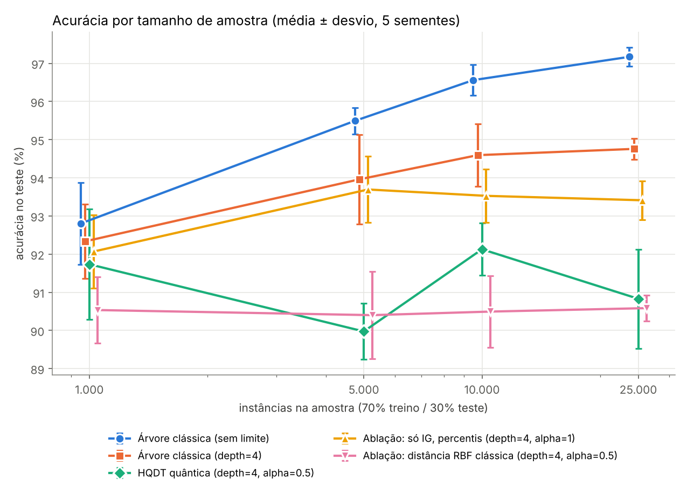

# HQDT-IDS: Árvore de Decisão Quântica Híbrida para Detecção de Intrusão

Código e notebooks do artigo **"Uma Abordagem Híbrida de Árvore de Decisão Quântica para Detecção de Intrusão em Redes"**
(Julio C. T. Buzzi e Matheus A. Souza, PUC Minas). [PDF do artigo](https://juliobuzziportfolio.vercel.app/artigo-hqdt-ids.pdf)

A HQDT é uma árvore de decisão em que o critério de corte mistura o ganho de informação de Shannon com uma distância calculada por **fidelidade quântica**:

```
S(f, t) = α · IG + (1 − α) · (1 − |⟨ψ(x_esq)|ψ(centróide)⟩|²)
```

Os pontos são reduzidos a 3 componentes com PCA e codificados em 3 qubits com um `ZZFeatureMap` (Qiskit, simulação statevector).

## Notebooks

| Notebook | O que tem |
|---|---|
| [`01_dados.ipynb`](notebooks/01_dados.ipynb) | NSL-KDD: download, classes, ataques novos no teste, pré-processamento (Label Encoding → StandardScaler → PCA 3) |
| [`02_hqdt.ipynb`](notebooks/02_hqdt.ipynb) | Circuito ZZFeatureMap, fidelidade, treino da HQDT, árvore impressa, uso do cache |
| [`03_comparacao.ipynb`](notebooks/03_comparacao.ipynb) | Reprodução da Tabela 1 com 5 sementes, precisão/recall/F1, ablações, KDDTest+, varredura de α e `reps` |

## Resultados (reprodução)

Protocolo: amostra estratificada de *n* instâncias do KDDTrain+, split 70/30 estratificado, pré-processamento ajustado só no treino, 5 sementes. Acurácia no teste (média ± desvio):

| Modelo | 1.000 | 5.000 | 10.000 | 25.000 |
|---|---|---|---|---|
| Árvore clássica (sem limite) | 92,8 ± 1,1 | 95,5 ± 0,3 | 96,6 ± 0,4 | 97,2 ± 0,2 |
| Árvore clássica (depth=4) | 92,3 ± 1,0 | 94,0 ± 1,2 | 94,6 ± 0,8 | 94,8 ± 0,3 |
| **HQDT (depth=4, α=0,5)** | 91,7 ± 1,4 | 90,0 ± 0,7 | 92,1 ± 0,7 | 90,8 ± 1,3 |
| Ablação: só IG + percentis (α=1) | 92,1 ± 1,0 | 93,7 ± 0,9 | 93,5 ± 0,7 | 93,4 ± 0,5 |
| Ablação: distância RBF clássica (α=0,5) | 90,5 ± 0,9 | 90,4 ± 1,1 | 90,5 ± 0,9 | 90,6 ± 0,3 |



O que a reprodução mostra:

- **Os números não batem com a Tabela 1 do artigo.** No artigo, a árvore clássica com depth=4 fica em 86,9% e a HQDT em 95,1% (25.000 instâncias). Aqui a ordem se inverte: a árvore clássica fica em 94,8% e a HQDT em 90,8%. O artigo não informa o protocolo de treino/teste, o `reps` do feature map nem a implementação da baseline. Por isso a diferença ainda precisa ser investigada com o script original dos experimentos.
- **A HQDT gera árvores menores.** Com 25.000 instâncias são ~8,8 folhas, contra ~14,8 da árvore clássica de mesma profundidade, o que confirma essa parte do artigo.
- **α importa.** Com α=0,75 a HQDT chega a 93,6% e supera a versão só com IG (93,1%), mas ainda fica abaixo do scikit-learn.
- **O cache de fidelidade não é usado.** As chaves (média da partição, centróide) nunca se repetem, então o cache teve 0 acertos.
- **No KDDTest+ oficial** (que tem 17 tipos de ataque que não estão no treino), todos os modelos ficam entre 71% e 77%. A HQDT tem precisão de ~98%, mas recall de ~51%.

Os CSVs completos estão em [`results/`](results).

## Como rodar

```bash
git clone https://github.com/JulioBuzzi/hqdt-ids.git
cd hqdt-ids
python -m venv .venv && source .venv/bin/activate
pip install -r requirements.txt
jupyter notebook notebooks/
```

O NSL-KDD é baixado automaticamente pra `data/` na primeira execução. Testado com Python 3.13, Qiskit 2.6 e qiskit-machine-learning 0.9.1. O notebook 03 roda em cerca de 2 minutos num notebook comum.

## Usando o classificador

```python
import sys; sys.path.insert(0, "src")
from hqdt import HybridQuantumDecisionTree, make_split

X_tr, X_te, y_tr, y_te = make_split(5000, seed=0)
model = HybridQuantumDecisionTree(max_depth=4, alpha=0.5, distance="quantum").fit(X_tr, y_tr)
print(model.score(X_te, y_te))
print(model.print_tree(["PC1", "PC2", "PC3"], ["normal", "ataque"]))
```

Opções de `distance`: `"quantum"` (fidelidade), `"rbf"` (kernel clássico) ou `"none"` (só IG).

## Estrutura

```
src/hqdt/
  tree.py         # HybridQuantumDecisionTree (compatível com scikit-learn)
  data.py         # download e pré-processamento do NSL-KDD
  experiments.py  # protocolo dos experimentos do notebook 03
notebooks/        # 01, 02, 03
results/          # CSVs e gráfico
```

## Diferenças em relação ao código original

O classificador veio de [`JulioBuzzi/qiskit-machine-learning`](https://github.com/JulioBuzzi/qiskit-machine-learning/blob/main/qiskit_machine_learning/algorithms/classifiers/quantum_decision_tree.py). Ele manteve o mesmo critério de corte, e estas foram as mudanças:

- corrigido um erro quando nenhum corte tem ganho > 0 (antes quebrava com `X[:, None]`)
- `alpha`, `reps` e `percentiles` viraram parâmetros (antes eram fixos no código)
- opções `distance="rbf"` e `"none"` pras ablações
- contadores de chamadas ao kernel e de acertos no cache
- o centróide é calculado uma vez por nó, e não uma vez por candidato

## Citação

```bibtex
@article{buzzi_souza_hqdt,
  title  = {Uma Abordagem H{\'\i}brida de {\'A}rvore de Decis{\~a}o Qu{\^a}ntica para Detec{\c{c}}{\~a}o de Intrus{\~a}o em Redes},
  author = {Buzzi, Julio C. T. and Souza, Matheus A.},
  institution = {PUC Minas},
  year   = {2026}
}
```